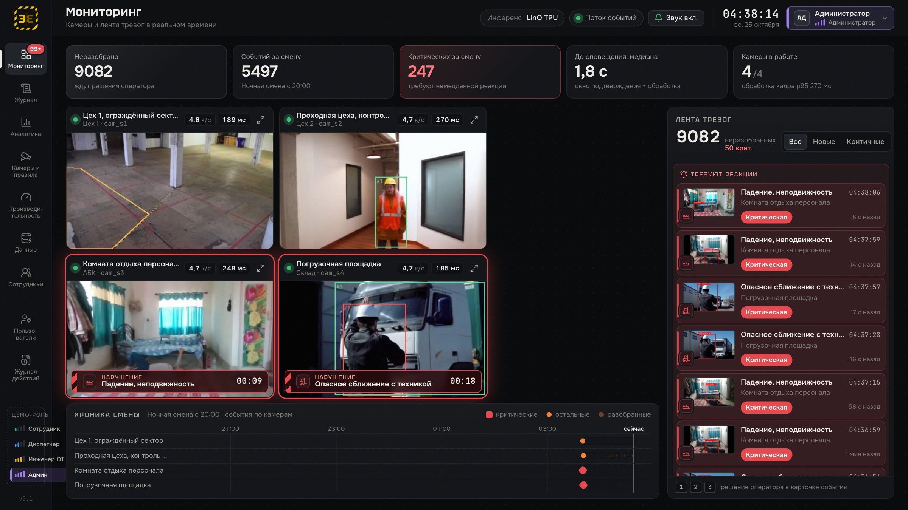
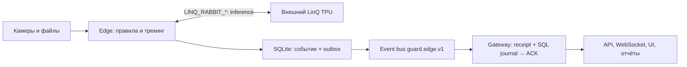

# Зазеркалье — нарушения техники безопасности на видео в реальном времени, на ускорителе LinQ TPU

Хакатон «Открой#Моспром», кейс LinQ. Команда «Зазеркалье».

**Что это.** Веб-сервис, который смотрит видео с камер предприятия и в реальном времени сообщает о нарушениях техники безопасности: вход в опасную зону, отсутствие каски или жилета, падение и неподвижность, опасное сближение с техникой, бег, телефон, курение или огонь, перелезание через ограждение. EventManager подтверждает нарушения по временному окну и подавляет повторы. Карточка события содержит камеру, участок, зону, время, тип и доступные медиа; доставка клипов между edge и gateway пока не реализована. Production-путь запускает нейросети на внешнем **LinQ TPU** без автоматического перехода на CPU. Текущая доступность и качество подтверждаются отдельной активной приёмкой; запуск процесса и прежние замеры этого не доказывают.

**Для кого** — семь ролей из кейса:

- специалист по охране труда рисует зоны и включает правила без кода;
- мастер получает одно оповещение и пресекает нарушение;
- диспетчер разбирает ленту тревог, критичные идут первыми;
- служба охраны труда и юристы ведут журнал-доказательство;
- менеджмент смотрит статистику по участкам и сменам;
- ИТ-служба видит FPS и задержки по узлам;
- работники и водители техники получают защиту и одинаковые для всех правила.

Подробнее — `docs/ANALYTICS.md`.



Презентация к защите: [PPTX](deliverables/presentation-v2/zazerkalye-v2.pptx), [PDF](deliverables/presentation-v2/zazerkalye-v2.pdf).

## Содержание

- [Архитектура](#архитектура)
- [Ключевые цифры на LinQ](#ключевые-цифры-на-linq)
- [Сценарии и статус](#сценарии-и-статус)
- [Production-запуск на LinQ](#production-запуск-на-linq)
- [Демо на защите: TPU, 7 камер](#демо-на-защите-tpu-7-камер)
- [Роли и вход](#роли-и-вход)
- [Локальная проверка перед запуском](#локальная-проверка-перед-запуском)
- [CPU-диагностика](#cpu-диагностика)
- [Режимы local, edge и gateway](#режимы-local-edge-и-gateway)
- [Отчёты и оценка](#отчёты-и-оценка)
- [Схема «edge на стенде LinQ + gateway на ноутбуке»](#схема-edge-на-стенде-linq--gateway-на-ноутбуке)
- [Как добавить новый тип нарушения](#как-добавить-новый-тип-нарушения)
- [Интерфейс](#интерфейс)
- [Структура репозитория](#структура-репозитория)
- [Документы](#документы)

## Архитектура

1. **Edge** рядом с камерами и TPU: декод → препроцессинг → внешний LinQ → ONNX-хвост/NMS → трекинг → правила → EventManager.
2. Событие и outbox сохраняются вместе в SQLite. Отдельный event bus `guard.edge.v1` переносит durable события и ограниченную временную телеметрию с JPEG.
3. **Gateway** фиксирует receipt и событие до ACK, ведёт операторский журнал, HTTP API и WebSocket. Он не загружает модели и не открывает источники видео.
4. **UI** показывает мониторинг, карточки событий, SQL-аналитику, отчёты и состояние камер. Камеры меняются на local/edge; на gateway каталог только для чтения.



Почему конвейер стоит рядом с TPU: с ноутбука через VPN один кадр YOLO идёт **3.3 с**, а из контейнера рядом с брокером — **0.04 с**. Подробно — `docs/ARCHITECTURE.md` §3 (решение D-005).

**Маховик данных.** Система сама собирает обучающую выборку. Сырой кадр каждого события, рамки с уверенностью у порога, смена ID трека и решение оператора («ложное» — hard negative) пишутся в `data/flywheel` в фоне и не задерживают оповещение. Учитель предлагает разметку (`ml/flywheel/autolabel.py`), человек её принимает на странице «Данные», `python -m ml.flywheel.export` собирает версию датасета в YOLO, `ml/flywheel/train.py` и `ml/flywheel/gate.py` дообучают модель и сравнивают её с базой; выкатки (`ml/flywheel/deploy.py`) в main пока нет. Кадры роликов оценки в обучение не попадают. В режиме edge + шлюз сэмплы идут со стенда на шлюз своей очередью AMQP, не больше 4 КБ/с на камеру, и очередь событий не ждёт. Первый оборот сделан на открытых данных — модель погрузчика `forklift-v1` ([docs/MODELS.md](docs/MODELS.md), `ml/model_cards/`). API — `/api/flywheel/*`, контракт и устройство — [docs/FLYWHEEL.md](docs/FLYWHEEL.md).

`GUARD_RABBIT_URL` задаёт event bus; параметры `LINQ_RABBIT_HOST/PORT/USER/PASSWORD` — отдельный канал inference. Они не подменяют друг друга. `GUARD_MODE` выбирает размещение компонентов, `GUARD_BACKEND` — backend inference. Локальные developer defaults остаются `local`/`onnx-cpu`; production entrypoints ниже явно выбирают внешний TPU и отключают fallback.

## Ключевые цифры на LinQ

Исторические замеры из upstream-материалов 24.10.2026, 00:52–01:55 МСК, контейнер Jupyter на стенде хакатона: 1.5 CPU, 4 ГиБ. Источник — `data/historical_validation_20261024/tpu-baseline.json`, таблицы и методика — **[docs/BENCHMARKS.md](docs/BENCHMARKS.md)**. Очередь TPU общая с другими командами, поэтому цифры зависят от их нагрузки. Эти результаты относятся к указанным моделям и прежнему окружению; они не являются свежей приёмкой объединённого durable-конвейера.

| Что | LinQ TPU | CPU (onnxruntime, тот же контейнер) |
|---|---|---|
| YOLOv8n det 480, кадров/с (окно 1 / 4 / 8 задач) | **22.8 / 38.0 / 45.7** | 8.3–9.3 (1000 / p50) |
| YOLOv8n det 480, кадр p50 / p95 | **40.5 / 64.0 мс**, из них `inference_time` 8 мс | 107–120 / 140–189 мс |
| YOLOv8n-pose 480, кадров/с (окно 1 / 4 / 8) | **24.1 / 44.7 / 50.1** | 7.1 |
| det + pose 480 на каждый кадр, батч 8 | **21.1 кадра/с**, батч p50 385 мс | — |
| Точность TPU относительно CPU, 30 отложенных кадров | det 480: recall 0.95, precision 0.97 при пороге TPU 0.25; pose 480: 0.98 / 1.00, средняя ошибка keypoint'ов 2.2 пикс. | эталон fp32 |
| Камер на один TPU при анализе 5 к/с | **≈ 9** только det 480; **≈ 4** с det + pose 480 | — |

В этих материалах raw-режим (клиент сам пакует int8) дал ×1.9–2.3 относительно штатной упаковки при совпадении выходов. Для текущего релиза это нужно повторно проверять с его моделями и программами TPU.

## Сценарии и статус

Плагины S1–S10 и три дополнительных правила — `wrong_way`, `zone_dwell`, `zone_overcapacity` ([VIOLATION_EXPANSION_RESULTS](docs/VIOLATION_EXPANSION_RESULTS.md)) — находятся в `guard/rules/plugins/`, их синтетические проверки — в `tests/`. Наличие плагина, ONNX или `.tpu` не подтверждает event-level precision/recall на текущем релизе. Видео и веса не входят в git; рецепты, источники и интервальная разметка заданы в `tools/data_manifest.json`.

| Сценарий | Плагин | Роли моделей | Проверки и ограничения |
|---|---|---|---|
| S1: вход в опасную зону | `zone_intrusion` | det | Измеренная CPU-оценка двух роликов и границы выводов — [S1_EVALUATION](docs/S1_EVALUATION.md); на 13 размеченных роликах — 4 из 4 ([QUALITY](docs/QUALITY.md)) |
| S2: каска и жилет | `ppe_missing` | det + ppe | [AP и покрытие классов](docs/PPE_EVALUATION.md), [подготовка S2/clean](docs/S2_DATA_PREPARATION.md); отсутствие PPE-детекции означает unknown; на 13 роликах — 5 из 6 |
| S3: падение и неподвижность | `fall_immobile` | det + pose | На 13 роликах — 6 из 7; на отложенной выборке падений из открытых наборов — около половины ([QUALITY](docs/QUALITY.md)) |
| S4: близость техники | `vehicle_proximity` | det | Интервальная разметка не содержит actor ID; нужна проверка привязки участников. На 13 роликах — 2 из 4; дообученная модель погрузчика `forklift-v1` событий пока не добавила ([MODELS](docs/MODELS.md)) |
| S5: бег | `running` | det | Синтетические тесты не заменяют размеченный benchmark |
| S6: телефон | `phone_usage` | det + pose | Качество зависит от видимости мелкого объекта и позы. 1 из 1 после правки геометрии; правило, включённое на всех 13 роликах, ложных тревог не дало |
| S7: курение/огонь | `smoking_fire` | fire | Программа `fire_640s1` на TPU сверена с CPU ([LINQ_NOTES](docs/LINQ_NOTES.md) §17). Сигарету модель огня не видит (0 из 1): для курения нужна отдельная модель |
| S8: ограждение | `fence_climb` | det + pose | Нужны размеченные сцены с геометрией ограждения |
| S9: высота без привязи | `height_no_harness` | det | В strict-режиме без модели привязи это контроль доступа в зону высоты |
| S10: переноска груза | `unsafe_carry` | det + pose | Эвристики по позе требуют отдельной проверки качества |

Качество оповещений на 13 размеченных роликах (535 с, 23 события, офлайн-прогон на CPU): P 1.00, R 0.78 (18 из 23), 0 дублей, 0 ложных тревог, задержка p50 2.35 с — [QUALITY](docs/QUALITY.md). Это малая выборка: разбор ошибок и ограничения — там же.

Актуальный объём тестов получают командой `.venv/bin/python -m pytest --collect-only -q`; историческое число тестов не используется как статус текущей интеграции.

## Production-запуск на LinQ

На стенде должны быть подготовлены Python 3.11, окружение `~/guard311`, данные и модели из `configs/cameras.stand.yaml` / `configs/models.stand.yaml`. TPU-программы, manifest и CPU-хвосты обязаны соответствовать реестру. Перед запуском проверьте пути `edge.data_dir`, `edge.models_dir` и доступность всех требуемых ролей моделей.

С ноутбука через готовые локальные пробросы RabbitMQ/Jupyter (например, внешнюю Lima VM или VPN-контейнер проекта):

```bash
python tools/stand.py --url http://127.0.0.1:8888/ status
python tools/stand.py --url http://127.0.0.1:8888/ start --config configs/cameras.stand.yaml
scripts/run_tpu.sh
# Для внешнего туннеля, без попытки автоматически поднять другой VPN:
GUARD_VPN_MODE=external scripts/run_tpu.sh
```

`tools/stand.py start` запускает `python -m guard.edge` с `linq-tpu`, transport `rabbit`, `GUARD_BACKEND_FALLBACK=none`, `LINQ_RAW=1` и `LINQ_TIMEOUT_S=5`. Конфигурация камер содержит секцию `edge:`; `--config`, `--models-config`, `--backend`, `--transport`, `--url`, `--duration` и `--node-id` поддерживаются CLI edge. `stand.py --url` относится к JupyterHub, а `guard.edge --url` — к event bus.

`run_tpu.sh` в режиме `GUARD_VPN_MODE=auto` сначала проверяет готовые AMQP/HTTP-пробросы и использует их без запуска другого VPN. Если они недоступны, он пробует VPN-контейнер проекта. `external` только проверяет существующие пробросы и при отказе завершается без VPN up; `container` явно выбирает контейнер проекта. Адреса задаются `GUARD_RABBIT_URL` и `JUPYTER_LOCAL_URL`.

После проверки доступа скрипт запускает edge, если процесс отсутствует, и открывает gateway/UI. `SYNC=1 scripts/run_tpu.sh` отдельно синхронизирует код и перезапускает процесс; используйте это осознанно. Ни один из этих запусков автоматически не очищает очередь или durable outbox. Доступность AMQP/HTTP и живой PID не подтверждают, что inference действительно идёт на TPU.

Активная приёмка должна показать выбранный `linq-tpu`, отключённый CPU fallback, новые успешные вызовы каждой требуемой модели в наблюдаемом интервале, свежие обработанные кадры и итоговое событие/телеметрию на gateway. `stand.py health` показывает процесс и passive queue state с `inference_verified=false`; накопленные сообщения и старые счётчики не заменяют такую проверку.

### Демо на защите: TPU, 7 камер

Edge на стенде уже работает (`python tools/stand.py status`). Пробросы RabbitMQ и Jupyter даёт VPN-контейнер (`infra/vpn/vpnctl.sh status`). Шлюз и UI запускаются на ноутбуке, адрес — http://127.0.0.1:8000:

```bash
GUARD_PREVIEW_STALE_AFTER_S=30 GUARD_VPN_MODE=external scripts/run_tpu.sh
```

- Вход включён. Демо-учётки: `admin/admin`, `safety/safety`, `operator/operator`, `worker/worker` (роли — [ROLES](docs/ROLES.md)).
- За 15–20 минут до показа выполнить `scripts/reset_demo_journal.sh`. Скрипт останавливает шлюз, переносит журнал в `data/archive/guard-<дата-время>.db`, засевает демо-сотрудников и снова запускает шлюз той же командой. Зацикленные ролики за ночь набирают тысячи событий, и счётчики «Мониторинга» перестают быть правдоподобными. Если в браузере открыт UI, шлюз ждёт его соединений; через 15 с скрипт добивает процесс SIGKILL. Если он всё же напишет «шлюз не остановился», добить процесс на :8000 вручную и запустить скрипт снова.
- Камеры (`configs/cameras.stand.yaml`), 7 штук: 4 основные сцены `cam_s1`–`cam_s4` (вход в зону, каски, падение, техника; 4 к/с), `cam_s6` — телефон (3 к/с), `cam_s7` — курение и огонь (2 к/с), `cam_live1` — живая трансляция YouTube Live с перекрёстка Сибуя (2 к/с; сближение с машинами и бег). Перед показом проверить, что трансляция в эфире: на стенде `~/guard311/bin/python -m yt_dlp --print live_status <ссылка>` должен вывести `is_live`; иначе заменить ссылку или поставить ролик.
- Превью со стенда — 320 px (`edge.settings.preview_max_width`): ~7 КБ на кадр, 7 камер × 1 к/с — ~50 КиБ/с, остаток канала — событиям со снимком. `GUARD_PREVIEW_STALE_AFTER_S=30`: часы стенда отстают от ноутбука на ~4.7 с, а в канале стенд → ноутбук бывают всплески до 10–15 с. С 30 с превью не гаснет на таких всплесках.
- 25.10, 4 камеры, 10 минут на TPU: превью живы 100 % времени; оповещение появляется в UI через ~1.5 с после подтверждения нарушения (~2.7 с от его начала); CPU edge — 1.06 ядра. 7 камер, 07:05, 60 с: превью 7/7 живы 100 % времени, CPU edge ~1.36 ядра (с 8 камерами было 1.40 ядра и превью старше 30 с, поэтому восьмая убрана). Подробности и файлы замеров — [EDGE](docs/EDGE.md) §7.1а.
- Канал стенд → ноутбук — ~115 КиБ/с, и он общий со всем трафиком ноутбука. Во время показа на ноутбуке ничего не качать и не пушить: оповещения начинают опаздывать на десятки секунд.

## Роли и вход

Вход включён по умолчанию: логин и пароль, cookie-сессия `guard_session`. Права проверяет сервер — запрос без права получает 403 с названием права, интерфейс только прячет недоступное. Матрица прав — `guard/auth/roles.py`, подробно — [ROLES](docs/ROLES.md).

| Роль | Кто на производстве | Что делает в системе |
|---|---|---|
| Сотрудник (`worker`) | рабочий, бригадир | Аналитика и журнал событий без снимков и видео, справочник сотрудников |
| Диспетчер смены (`operator`) | мастер, диспетчер | + Мониторинг с видео, разбор событий (подтвердить, ложное, закрыть, заметка), виновники инцидента, Производительность |
| Инженер по ОТ (`safety`) | специалист по охране труда | + зоны и правила камер, проверка кадров маховика данных, журнал действий |
| Администратор (`admin`) | ИТ, владелец системы | Всё: подключение и удаление камер, учётные записи, обучение и выкатка моделей |

- Настройки: `GUARD_AUTH` (по умолчанию `1`; `0` — все запросы идут как `admin`), `GUARD_DEMO_LOGIN` (по умолчанию `1`), `GUARD_AUTH_DB` (по умолчанию `<data_dir>/auth.db`).
- Демо-учётки, пароль равен логину: `admin`, `safety`, `operator`, `worker`. Для реального объекта `GUARD_DEMO_LOGIN=0` и сменить пароли (`python -m guard.auth set-password <логин>`).
- Чья роль сейчас, видно в шапке: бейдж с цветом и уровнем допуска, по клику — карточка «Что может эта роль». При демо-входе в колонне навигации есть панель «Демо-роль» — смена роли в один клик.
- Вход, изменения камер, зон, правил, статусов событий и учётных записей пишутся в журнал действий (страница «Журнал действий», `GET /api/audit`).

## CPU-диагностика

Это явный отдельный режим для разработки и воспроизведения проверок. Он не служит доказательством работы внешнего TPU.

```bash
uv venv --python 3.11 .venv
uv pip install --python .venv/bin/python --requirements pyproject.toml --extra dev
export GUARD_DATA_DIR="$PWD/data" GUARD_MODELS_DIR="$PWD/models"

# UI
(cd frontend && npm ci && npm run build)

# При подготовленных моделях и входах из docs/DATA.md:
GUARD_MODE=local GUARD_BACKEND=onnx-cpu \
  GUARD_CAMERAS_CONFIG="$PWD/configs/cameras.cpu-demo.yaml" scripts/run_dev.sh
```

Экспорт ONNX описан в [MODELS](docs/MODELS.md), включая `ml/export_onnx.py --preset coco` и экспорт пользовательской модели через `--weights/--out/--model-id`. Ultralytics нужен для экспорта; runtime ONNX не скачивает веса автоматически. Подготовка демо-видео выполняется `tools/fetch_data.py` по manifest; конкретные пути должны совпадать с выбранным camera YAML. Для S2 и чистого контроля есть отдельная [инструкция](docs/S2_DATA_PREPARATION.md).

Мок-интерфейс доступен через `?mock=1` или `npm run dev:mock` в `frontend/`; он не проверяет ML/runtime. Параметры `GUARD_MAX_BATCH`, `GUARD_ORT_THREADS`, `HOST` и `PORT` относятся к выбранному режиму; полный перечень — `guard/pipeline/settings.py`.

## Схема «edge на стенде LinQ + gateway на ноутбуке»

| Действие | Команда или источник |
|---|---|
| Доступ к стенду | Готовые пробросы Lima/VPN: `GUARD_VPN_MODE=external`; контейнер проекта при необходимости — `infra/vpn/vpnctl.sh up`. Параметры доступа остаются вне git |
| JupyterHub и перенос кода | `python tools/stand.py sync`; корень удалённого checkout — `~/work/mosprom` |
| Перенос выбранных роликов | `python tools/stand.py sync-data --videos s1_01,s2_01,s3_02,s4_02,s6_01,s7_01` |
| Проверка/запуск процесса | `python tools/stand.py status`, `start`, `logs`, `health`; это не активная TPU-приёмка |
| Повторный запуск после обновления | `python tools/stand.py restart --config configs/cameras.stand.yaml` |
| Сборка программ TPU | `python tpu/compile.py --help`, [LINQ_NOTES](docs/LINQ_NOTES.md); программы и manifest хранятся вне git |
| Изолированный smoke det/pose | На подготовленном стенде: `GUARD_BACKEND_FALLBACK=none LINQ_RAW=1 LINQ_TIMEOUT_S=5 ~/guard311/bin/python tpu/smoke_backend.py`; это не проверка всех камер/моделей |
| Gateway на ноутбуке | `scripts/run_tpu.sh`; события и receipt хранятся локально, модели и источники на gateway не нужны |

Файлы данных загружаются в `~/work/mosprom/data/videos`. Если `edge.data_dir` указывает на `data_360`, его подготовку выполняют отдельно: `sync-data` сам не создаёт уменьшенные видео. Производительность и задержки старого транспорта из [EDGE](docs/EDGE.md) и [BENCHMARKS](docs/BENCHMARKS.md) не переносятся автоматически на протокол `guard.edge.v1`.

## Локальная проверка перед запуском

Из корня проекта, в окружении с установленными зависимостями:

```bash
python -m guard.doctor
python -m guard.doctor --json
GUARD_DATA_DIR=/path/to/data GUARD_MODELS_DIR=/path/to/models python -m guard.doctor --json
```

Проверка использует `Settings` и переменные `GUARD_*`, включая `GUARD_CAMERAS_CONFIG`, `GUARD_MODELS_CONFIG`, `GUARD_DB_PATH` и `GUARD_MEDIA_DIR`. Относительные пути источников разрешаются так же, как в конвейере: сначала от каталога данных, затем от его родителя и текущего каталога; относительные пути моделей — от каталога моделей. Абсолютные пути поддерживаются.

Doctor читает YAML камер и реестра, проверяет структуру и семантику конфигурации, наличие файлов моделей для включённых правил включённых камер, локальные источники `file`/`images`, типы и разрешения выходных путей или их ближайших существующих родителей. Он не создаёт каталоги данных, БД, медиа или конфиги. Отсутствие ещё не созданных выходных каталогов допустимо, если родитель доступен для записи. Изображения перечисляются по расширениям без декодирования; пустой каталог — ошибка. Отключённые камеры и правила не требуют файлов источников и моделей.

В отчёте `scope: offline` и статусы `ok`, `error`, `warning`, `skipped`; JSON выводится одним объектом в stdout. Код выхода: `0` — локальных ошибок нет (предупреждения и пропуски допустимы), `1` — найдены ошибки, `2` — неверные аргументы CLI. Значения URI и содержимое ошибок разбора скрываются, чтобы не выводить пароли.

RTSP, webcam, сеть, загрузка моделей, ORT и TPU не запускаются. Для `linq-tpu` проверяется наличие локального `tpu_program`; `file://` обозначает путь на TPU-воркере и получает `skipped`. Зависимость от ONNX, manifest и CPU tail при загрузке TPU также остаётся непроверенной. Успешный doctor подтверждает только доступные локальные проверки: он не доказывает валидность содержимого моделей/видео, доступность TPU или камер, возможность фактической записи, скорость и качество детекции. В свежем checkout включённые камеры сообщат об отсутствующих данных и моделях до их подготовки.

## Воспроизводимая CPU-проверка

Подготовка det ONNX: [docs/MODELS.md](docs/MODELS.md); публичные видео, лицензии и отдельный demo-конфиг: [docs/DATA.md](docs/DATA.md). Веса и видео хранятся вне Git. После подготовки файлов и установки dev-зависимостей из корня проекта:

```bash
GUARD_MODE=local GUARD_BACKEND=onnx-cpu python -m tools.cpu_smoke --data-dir "$PWD/data" --models-dir "$PWD/models" --timeout 60 --json
```

Команда проверяет настоящие file source/ONNX/worker, событие S1 в HTTP и WebSocket, операторский PATCH, JPEG и H.264-клип. Отдельные БД, медиа и отчёт сохраняются в новом `data/cpu_async/` каталоге; существующие результаты не перезаписываются. Отсутствие события или медиа даёт ненулевой код выхода. Это однокамерная проверка работоспособности; качество детекции и TPU оцениваются отдельно.

Следующие проверки запускаются независимо:

```bash
GUARD_BACKEND=onnx-cpu .venv/bin/python -m ml.eval.run_s1 --timeout 180 --json
GUARD_BACKEND=onnx-cpu .venv/bin/python -m tools.cpu_multicamera --timeout 120 --json
```

[Оценка S1](docs/S1_EVALUATION.md) проходит 600 выбранных кадров двух размеченных роликов и сохраняет predictions/метрики. [Три камеры](docs/CPU_MULTICAMERA.md) проверяют полные исходные файлы в реальном времени, нагрузку, медиа и завершение. [Настоящий RabbitMQ](docs/RABBIT_ACCEPTANCE.md) проверяется отдельно, с собственным loopback-брокером и аварийными остановками edge/gateway.

## Режимы local, edge и gateway

По умолчанию `GUARD_MODE=local`: камеры, инференс, журнал и интерфейс работают в одном процессе:

```bash
GUARD_MODE=local GUARD_BACKEND=onnx-cpu python -m uvicorn guard.api.app:app --host 127.0.0.1 --port 8000
```

Для разделённого запуска задайте `GUARD_EDGE_ID` (одно безопасное имя для пары edge/gateway) и `GUARD_RABBIT_URL` в окружении каждого процесса. AMQP использует отдельный exchange `guard.edge.v1` и очереди `guard.gateway.<edge_id>.events` / `.telemetry.v2`; очереди инференса TPU не используются. Топология v2 совместима с RabbitMQ 4.4; правила миграции описаны в [EDGE_PROTOCOL.md](docs/EDGE_PROTOCOL.md). URL брокера содержит секреты: передавайте его через окружение, не коммитьте и не включайте в логи.

На машине с источниками и моделями:

```bash
GUARD_DATA_DIR=/path/to/edge-data GUARD_MODELS_DIR=/path/to/models GUARD_BACKEND_FALLBACK=none \
  python -m guard.edge --config configs/cameras.stand.yaml --models-config configs/models.stand.yaml \
  --backend linq-tpu --transport rabbit --node-id stand-linq
```

На машине с интерфейсом и операторским журналом:

```bash
GUARD_MODE=gateway GUARD_EDGE_ID=stand-linq GUARD_DATA_DIR=/path/to/gateway-data python -m uvicorn guard.api.app:app --host 127.0.0.1 --port 8000
```

Каталоги и SQLite edge/gateway должны быть раздельными. Gateway не читает реестр моделей, не создаёт inference backend и не открывает источники. Камеры приходят из каталога edge; менять их на gateway нельзя (HTTP 409), операторские статусы и заметки меняются локально. Изображения событий переносятся как JPEG и сохраняются под собственным media-каталогом gateway; клипы между edge и gateway не переносятся; `clip_path` на gateway остаётся `null`. Headless edge CLI отключает запись клипов.

Edge записывает событие и outbox в одной транзакции SQLite. Публикация подтверждается брокером до удаления outbox; неопределённый результат повторяется с тем же замороженным пакетом. Gateway фиксирует receipt и событие вместе, подавляет повторы и сохраняет решения оператора. При недоступности SQLite edge не переключается на журнал в памяти. Повреждённый/слишком большой JPEG передаётся как событие без изображения с transport-ошибкой.

При временном отказе записи edge удерживает весь пакет новых/закрытых событий и повторяет тот же event ID до commit. WS, счётчик созданных событий и планирование клипа выполняются после успешной записи/readback. Постоянный отказ явно виден и прерывает успешный shutdown; SQLite/backend сохраняются для повторного stop после восстановления. Crash до первого успешного сохранения при недоступном диске не покрыт durable replay.

Превью и метрики идут отдельным ограниченным каналом: `GUARD_PREVIEW_FPS` по умолчанию 1 (максимум 1), `GUARD_PREVIEW_MAX_WIDTH=480` (максимум 480), `GUARD_PREVIEW_STALE_AFTER_S=10`, `GUARD_TELEMETRY_INTERVAL_S=2`. Демо на стенде задаёт превью 320 px в `edge.settings` и `GUARD_PREVIEW_STALE_AFTER_S=30` на шлюзе (см. «Демо на защите»). Наложения рисуются на конкретном полученном JPEG. Каталог авторизует смену producer/run; старые последовательности, проходы источника и просроченные сообщения не возвращают старое превью. При устаревании JPEG API отвечает 503, а статус камеры показывает stale.

Локальная проверка без RabbitMQ, камер и моделей:

```bash
python -m pytest tests/test_edge_gateway.py tests/test_rabbit_transport.py tests/test_gateway_frames.py -q
```

Эти проверки используют реальный SQLite/HTTP/WS и внедрённый fake broker. Они не доказывают доступность живого AMQP-брокера, камер или TPU.

## Отчёты и оценка

`GET /api/analytics` считает агрегаты по всему отфильтрованному SQL-журналу в одной read-транзакции, независимо от пагинации `/api/events`. Подробный формат и включительные границы этого API — в [CONTRACTS](docs/CONTRACTS.md).

Сменный отчёт доступен по `GET /api/reports/shift?from=...&to=...&format=json|html|md`, готовые периоды — `GET /api/reports/presets`. Период отчёта полуоткрытый `[from,to)` по `confirmed_at`, даты без зоны трактуются по Москве. Без границ используется текущая смена 08–20/20–08; это отдельная семантика от включительных фильтров events/stats.

```bash
curl --fail 'http://127.0.0.1:8000/api/reports/presets'
curl --fail 'http://127.0.0.1:8000/api/reports/shift?format=html' -o shift.html
```

Оценка детекций PPE, S1-событий, сравнение моделей и качество нарушений — разные проверки: [PPE_EVALUATION](docs/PPE_EVALUATION.md), [S1_EVALUATION](docs/S1_EVALUATION.md), [MODEL_COMPARISON](docs/MODEL_COMPARISON.md). Нужны явные знаменатели, сохранённые predictions и readback; синтетические unit-тесты или успешный smoke не доказывают качество на независимом наборе.

## Как добавить новый тип нарушения

Новый тип нарушения — это новый модуль в `guard/rules/plugins/`. Конвейер, API и UI менять не нужно (требование R7):

- плагины находятся автоматически;
- подтверждение и дедупликацию делает `EventManager`;
- UI строит форму параметров по `params_schema`.

1. Создайте `guard/rules/plugins/crowding.py`:

```python
"""Скопление людей в зоне: больше N человек одновременно."""
from __future__ import annotations

from typing import Any, ClassVar

from guard.contracts import FrameContext, Severity, Violation
from guard.rules.base import RulePlugin, register_rule
from guard.rules.geometry import foot_point, is_zone_active, point_in_zone


@register_rule
class CrowdingRule(RulePlugin):
    type: ClassVar[str] = "crowding"                   # имя для configs/cameras.yaml и API
    title: ClassVar[str] = "Скопление людей в зоне"    # название в UI и журнале
    required_models: ClassVar[frozenset[str]] = frozenset({"det"})
    default_severity: ClassVar[Severity] = Severity.medium
    params_schema: ClassVar[dict[str, Any]] = {        # по этой схеме UI строит форму
        "type": "object",
        "title": "Скопление людей",
        "properties": {
            "max_people": {"type": "integer", "title": "Сколько человек допустимо в зоне",
                           "minimum": 1, "default": 3},
        },
        "additionalProperties": False,
    }

    def evaluate(self, ctx: FrameContext) -> list[Violation]:
        """Только «есть ли нарушение на этом кадре». Окно и дубли ведёт EventManager."""
        limit = int(self.cfg.params.get("max_people", 3))
        width, height = ctx.size
        out: list[Violation] = []
        for zone in self.camera.zones:
            if self.cfg.zones is not None and zone.zone_id not in self.cfg.zones:
                continue
            if not is_zone_active(zone, ctx.ts):        # расписание зоны, например 07:55-12:00
                continue
            inside = [t for t in ctx.people
                      if point_in_zone(foot_point(t.bbox), zone, width, height)]
            if len(inside) <= limit:
                continue
            box = (min(t.bbox[0] for t in inside), min(t.bbox[1] for t in inside),
                   max(t.bbox[2] for t in inside), max(t.bbox[3] for t in inside))
            out.append(self.violation(ctx, track_id=None, zone_id=zone.zone_id,
                                      bbox=box, details={"count": len(inside)}))
        return out
```

2. Добавьте тест `tests/test_rules_crowding.py`. Образец — `tests/test_rules_running.py`. Новый плагин нужно проверить на синтетике и размеченных сценах.
3. Перезапустите сервис. Тип появится в `GET /api/rules/types`, а на экране «Камеры и правила» его можно включить для камеры: выбрать зону, задать `max_people`, окно подтверждения `min_duration_s`, `cooldown_s` и важность.
4. По желанию добавьте иконку и короткое имя в `frontend/src/domain/violations.ts`. Без этого UI покажет `title` плагина.

Если правилу нужна новая модель, экспортируйте её в ONNX (`ml/export_onnx.py --weights ... --model-id ...`), скомпилируйте под TPU (`tpu/compile.py`) и пропишите в `configs/models.yaml`. Плагин запрашивает модель через `required_models`.

## Интерфейс

| Экран | Для кого | Скриншот |
|---|---|---|
| Мониторинг: камеры с оверлеями, лента тревог (критичные сверху, со звуком), хроника смены | диспетчер, мастер | `deliverables/presentation-v2/screens/monitoring.jpg` |
| Карточка события: кадр с рамкой, задержка по этапам, виновники инцидента, решение оператора клавишами 1/2/3; клип ±5 с — в режиме local | диспетчер | `deliverables/presentation-v2/screens/event.jpg` |
| Журнал: фильтры по периоду, типу, камере, зоне, статусу и важности, экспорт CSV | служба ОТ, юристы | `deliverables/presentation-v2/screens/journal.jpg` |
| Аналитика: по типам, участкам, камерам, «день недели × час», доля ложных по правилам, статистика по сотруднику | менеджмент, все роли | `deliverables/presentation-v2/screens/analytics.jpg` |
| Камеры и правила: полигон зоны рисуется мышью на стоп-кадре, расписание, формы правил | инженер по ОТ | `deliverables/presentation-v2/screens/zones.jpg` |
| Производительность: FPS по камерам, задержка по этапам p50/p95, модели на ускорителе | ИТ-служба, диспетчер | `deliverables/presentation-v2/screens/performance.jpg` |
| Данные (маховик): цикл из шести шагов, очередь проверки сэмплов с рамками (клавиши 1/2, ←/→), датасеты, модели с решением гейта | инженер по ОТ, администратор | `deliverables/presentation-v2/screens/data.jpg` |
| Сотрудники: справочник с поиском, виновники инцидента в карточке события, персональная статистика в «Аналитике» ([EMPLOYEES](docs/EMPLOYEES.md)) | все роли; добавляет сотрудников администратор | — |
| Пользователи: учётные записи, создание, смена роли, сброс пароля, матрица «роли × права» | администратор | — |
| Журнал действий: кто, когда и что менял; фильтры по периоду, пользователю и действию | инженер по ОТ, администратор | — |

Скриншоты в `deliverables/presentation-v2/screens/` сняты 25.10 в 04:38 с работающей системы: edge и инференс на LinQ TPU, шлюз на ноутбуке, вход `admin`, окно 1600×900. Тогда на стенде было 4 камеры. Исторические скриншоты локального CPU-бэкенда от 24.10 — `deliverables/screens/real-*.jpg`.

## Структура репозитория

```
guard/                бэкенд (Python 3.11, FastAPI)
  contracts.py        типы: Detection, Track, Violation, Event, CameraConfig, ModelSpec
  sources/            источники: файл, RTSP, папка кадров, веб-камера
  inference/          InferenceBackend: onnx_cpu.py, linq_tpu.py (облачный протокол LinQ, raw-кодек, окно задач)
  vision/             letterbox, декод YOLOv8 det и pose, NMS, отрисовка
  tracking/           ByteTrack и атрибуты человека (СИЗ, поза, телефон)
  pipeline/           движок камер, батчинг между камерами, воркер камеры, шина WS, настройки
  rules/              API правил (base.py), геометрия зон и расписаний, plugins/ — 13 типов нарушений
  events/             EventManager (подтверждение, дедуп), журнал SQLite, медиа (снапшот, клип)
  edge/               durable headless CLI, outbox publisher и telemetry
  gateway/            receipt/commit-before-ACK и JPEG preview
  transport/          versioned wire v1, store и AMQP
  reports/            сводка по смене
  flywheel/           маховик данных: сбор сэмплов, хранилище, задачи
  auth/               вход, сессии, роли и права, журнал действий
  employees.py        справочник сотрудников и персональная статистика
  edge_probe.py       наблюдение за очередями edge без потребления (--tap)
  doctor.py           офлайн-проверка конфигурации
  api/                HTTP API и WebSocket
frontend/             веб-интерфейс (React 18, TypeScript, Vite), мок-режим для резервного демо
tpu/                  компиляция ONNX → .tpu, калибровка, замеры, сверка TPU с CPU, установка на стенд
ml/                   экспорт в ONNX, оценка по событиям (ml/eval/), дообучение (ml/flywheel/, ml/datasets/), карточки (ml/model_cards/)
configs/              cameras.yaml (камеры, зоны, правила), models.yaml (реестр моделей)
tools/                stand.py (edge на стенде: sync, start, restart, logs), jhub.py (JupyterHub API),
                      fetch_data.py (демо-данные), stand_clock.py (сдвиг часов стенда), contact_sheet.py
                      (раскадровка роликов), heavy.sh и memguard.sh (защита от OOM)
infra/vpn/            OpenVPN в контейнере Podman для доступа к стенду
scripts/              run_dev.sh (локальный запуск), run_tpu.sh (шлюз и UI для edge на TPU),
                      reset_demo_journal.sh (чистый журнал перед показом)
tests/                unit- и интеграционные проверки pytest
docs/                 документация (см. ниже)
deliverables/         материалы для экспертов: финальная презентация deliverables/presentation-v2/, скриншоты
```

`data/`, `models/`, `vendor/` и `.env` в git не входят.

## Документы

| Файл | Что внутри |
|---|---|
| [docs/ARCHITECTURE.md](docs/ARCHITECTURE.md) | схема, режимы запуска, почему edge, модули, точки расширения |
| [docs/CONTRACTS.md](docs/CONTRACTS.md) | контракты модулей, HTTP API, WebSocket |
| [docs/EDGE_PROTOCOL.md](docs/EDGE_PROTOCOL.md) | durable wire v1, outbox/receipt и bounded telemetry.v2 |
| [docs/EDGE.md](docs/EDGE.md) | edge на стенде LinQ: запуск, камеры на TPU, сквозная задержка, стабильность; итоговые замеры канала стенд → ноутбук и демо 25.10 — §7.1а |
| [docs/BENCHMARKS.md](docs/BENCHMARKS.md) | замеры TPU и CPU, точность, канал, расчёт «камер на TPU» |
| [docs/LINQ_NOTES.md](docs/LINQ_NOTES.md) | конспект SDK и облачного протокола LinQ, компиляция, raw, грабли |
| [docs/TPU_PREFLIGHT.md](docs/TPU_PREFLIGHT.md) | проверка ONNX для TPU без SDK: разрез на голову и хвост (`python -m tpu.preflight`) |
| [docs/QUALITY.md](docs/QUALITY.md) | качество оповещений на 13 размеченных роликах: P, R, дубли, задержка, разбор ошибок, отложенная выборка падений |
| [docs/DATA.md](docs/DATA.md) | данные, демо-ролики, разметка и воспроизводимость проверок |
| [docs/MODELS.md](docs/MODELS.md), [docs/DATASETS.md](docs/DATASETS.md) | модели, их выбор и компиляция под TPU; открытые наборы и дообучение (`forklift-v1`, карточки — `ml/model_cards/`) |
| [docs/FLYWHEEL.md](docs/FLYWHEEL.md) | маховик данных: контракт, устройство, API |
| [docs/S1_EVALUATION.md](docs/S1_EVALUATION.md), [docs/MODEL_COMPARISON.md](docs/MODEL_COMPARISON.md) | воспроизводимая оценка событий и сравнение моделей |
| [docs/PPE_EVALUATION.md](docs/PPE_EVALUATION.md), [docs/S2_DATA_PREPARATION.md](docs/S2_DATA_PREPARATION.md) | AP, покрытие PPE-классов и pins входных данных |
| [docs/S2_EVALUATION.md](docs/S2_EVALUATION.md), [docs/S2_ROI_BOUNDARY_AB.md](docs/S2_ROI_BOUNDARY_AB.md), [docs/S2_SOURCE_BOUNDARY_DIAGNOSTIC.md](docs/S2_SOURCE_BOUNDARY_DIAGNOSTIC.md), [docs/CAPTURE_DISCONTINUITY.md](docs/CAPTURE_DISCONTINUITY.md) | оценка S2, A/B полного кадра и кропов людей, граница склеенных источников, `capture_id` |
| [docs/PPE_MODEL_CANDIDATE.md](docs/PPE_MODEL_CANDIDATE.md), [docs/PPE_VYRA_CANDIDATE.md](docs/PPE_VYRA_CANDIDATE.md), [docs/PPE_PERSON_ROI.md](docs/PPE_PERSON_ROI.md) | экспериментальные PPE-кандидаты BuildVision и Vyra, кропы людей для PPE (opt-in) |
| [docs/MISSING_RULE_MODELS_20261024.md](docs/MISSING_RULE_MODELS_20261024.md) | подбор моделей для незакрытых сигналов правил: страховочная привязь, сигарета, действия, респиратор |
| [docs/MODEL_RESEARCH_20261024.md](docs/MODEL_RESEARCH_20261024.md), [docs/MODEL_FAMILIES_RESEARCH_20261024.md](docs/MODEL_FAMILIES_RESEARCH_20261024.md), [docs/EXTENDED_MODEL_FAMILIES_20261024.md](docs/EXTENDED_MODEL_FAMILIES_20261024.md), [docs/HEAVY_MODEL_RESEARCH_20261024.md](docs/HEAVY_MODEL_RESEARCH_20261024.md), [docs/MODEL_FOLLOWUP_20261024.md](docs/MODEL_FOLLOWUP_20261024.md), [docs/HIGH_RESOLUTION_EVALUATION.md](docs/HIGH_RESOLUTION_EVALUATION.md) | исследование моделей 24.10: семейства, тяжёлые модели, разрешение 640 и 1280 |
| [docs/YOLO11_CANDIDATE.md](docs/YOLO11_CANDIDATE.md), [docs/RFDETR_CANDIDATE.md](docs/RFDETR_CANDIDATE.md), [docs/RFDETR_PARITY_DIAGNOSTICS.md](docs/RFDETR_PARITY_DIAGNOSTICS.md), [docs/RFDETR_QUALITY_COMPARISON.md](docs/RFDETR_QUALITY_COMPARISON.md), [docs/DFINE_DETECTOR_ADAPTER.md](docs/DFINE_DETECTOR_ADAPTER.md) | кандидаты детектора YOLO11, RF-DETR и D-FINE (opt-in, проверка на CPU) |
| [docs/VIOLATION_EXPANSION_PLAN.md](docs/VIOLATION_EXPANSION_PLAN.md), [docs/VIOLATION_EXPANSION_RESULTS.md](docs/VIOLATION_EXPANSION_RESULTS.md), [docs/VIOLATION_API_INTEGRATION.md](docs/VIOLATION_API_INTEGRATION.md) | расширение правил: план, результаты, сквозная проверка через HTTP и WebSocket |
| [docs/RULE_WRONG_WAY.md](docs/RULE_WRONG_WAY.md), [docs/RULE_ZONE_DWELL.md](docs/RULE_ZONE_DWELL.md), [docs/RULE_ZONE_OVERCAPACITY.md](docs/RULE_ZONE_OVERCAPACITY.md) | новые правила: движение против направления, пребывание в зоне, превышение числа людей |
| [docs/RULE_OBSERVATIONS.md](docs/RULE_OBSERVATIONS.md), [docs/RULE_CONFIG_VALIDATION.md](docs/RULE_CONFIG_VALIDATION.md), [docs/RULE_ZONE_METADATA.md](docs/RULE_ZONE_METADATA.md), [docs/RULE_CONFIG_UI.md](docs/RULE_CONFIG_UI.md) | статус наблюдения моделей, проверка конфигурации правил, `zone_schema`, редактор правил |
| [docs/CPU_MULTICAMERA.md](docs/CPU_MULTICAMERA.md), [docs/RABBIT_ACCEPTANCE.md](docs/RABBIT_ACCEPTANCE.md) | границы CPU и AMQP-приёмок |
| [docs/IMPLEMENTATION_PLAN.md](docs/IMPLEMENTATION_PLAN.md), [docs/MAIN_INTEGRATION_20261024.md](docs/MAIN_INTEGRATION_20261024.md) | план развития и результаты интеграции 24.10 |
| [docs/ROLES.md](docs/ROLES.md), [docs/EMPLOYEES.md](docs/EMPLOYEES.md) | роли и права: сотрудник, диспетчер смены, инженер по ОТ, администратор; вход, сессии, журнал действий, проверка безопасности; справочник сотрудников и персональная статистика |
| [docs/ANALYTICS.md](docs/ANALYTICS.md) | целевая аудитория, проблемы UX, конкуренты и аналоги |
| [docs/PITCH.md](docs/PITCH.md) | структура защиты и экономика внедрения |
| [docs/REQUIREMENTS_MATRIX.md](docs/REQUIREMENTS_MATRIX.md), [docs/DEMO_SCRIPT.md](docs/DEMO_SCRIPT.md) | матрица требований R1–R7, D1–D5 и сценарий показа на защите (снимок 24.10 17:55) |
| [docs/EXPERT_CALL.md](docs/EXPERT_CALL.md) | решение, данные и результаты — к созвону с экспертами |
| [docs/CHECKPOINT_2.md](docs/CHECKPOINT_2.md) | материал к чек-поинту 2 (24.10 11:00) |
| [docs/CHECKPOINT_3.md](docs/CHECKPOINT_3.md) | материал к чек-поинту 3 (24.10 18:00) |
| [deliverables/presentation-v2/README.md](deliverables/presentation-v2/README.md) | финальная презентация к защите: сборка PPTX и PDF, пересъёмка скриншотов |
| [frontend/README.md](frontend/README.md) | экраны, режимы сборки, мок-режим |

## Модели и лицензии

- YOLOv8n и YOLOv8n-pose (COCO), Ultralytics, AGPL-3.0 — основа det и pose на TPU.
- PPE-кандидат: [constructelligence/construction-site-safety-hazards](https://huggingface.co/constructelligence/construction-site-safety-hazards); provenance, карты классов, экспериментальный статус и ограничения — в [MODELS](docs/MODELS.md) и [PPE_EVALUATION](docs/PPE_EVALUATION.md).
- Источник модели огня/дыма: [rabahdev/fire-smoke-yolov8n](https://huggingface.co/rabahdev/fire-smoke-yolov8n); наличие её записи в реестре не подтверждает активную работу текущей TPU-программы. Сверка программы `fire_640s1` с CPU — [LINQ_NOTES](docs/LINQ_NOTES.md) §17; на стенде правило `smoking_fire` включено на камере `cam_s7`.
- Погрузчик: `forklift-v1` — YOLOv8n COCO, дообученная на открытых наборах `forklift-ds-v1`; источники наборов — [DATASETS](docs/DATASETS.md), метрики — `ml/model_cards/forklift-v1.json`. Модель есть в реестре, на камерах и на стенде не включена.
- Источники и лицензии демо-видео — в `tools/data_manifest.json` и `data/labels/*.json` (поле `sources`).
