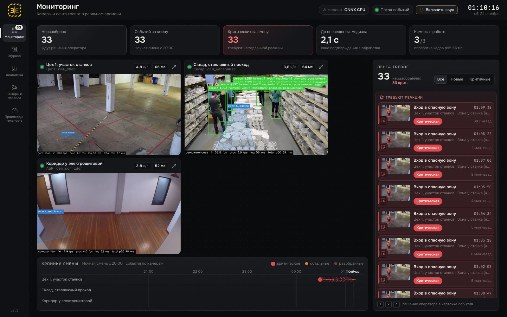
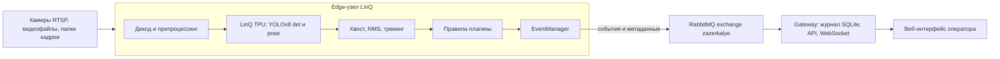

# Зазеркалье — нарушения техники безопасности на видео в реальном времени, на ускорителе LinQ TPU

Хакатон «Открой#Моспром», кейс LinQ. Команда «Зазеркалье».

**Что это.** Веб-сервис, который смотрит видео с камер предприятия и в реальном времени сообщает о нарушениях техники безопасности: вход в опасную зону, отсутствие каски или жилета, падение и неподвижность, опасное сближение с техникой, бег, телефон, курение или огонь, перелезание через ограждение. Каждое нарушение даёт **одно** оповещение. В нём кадр с выделенным человеком, клип ±5 с, камера, участок, зона, время и тип. Нейросети работают на российском ускорителе **LinQ TPU** — скорость и точность подтверждены замерами на стенде.

**Для кого** — семь ролей из кейса:
- специалист по охране труда рисует зоны и включает правила без кода;
- мастер получает одно оповещение и пресекает нарушение;
- диспетчер разбирает ленту тревог, критичные идут первыми;
- служба охраны труда и юристы ведут журнал-доказательство;
- менеджмент смотрит статистику по участкам и сменам;
- ИТ-служба видит FPS и задержки по узлам;
- работники и водители техники получают защиту и одинаковые для всех правила.

Подробнее — `docs/ANALYTICS.md`.



## Содержание

- [Архитектура](#архитектура)
- [Ключевые цифры на LinQ](#ключевые-цифры-на-linq)
- [Сценарии и статус](#сценарии-и-статус)
- [Запуск локально (режим local, CPU)](#запуск-локально-режим-local-cpu)
- [Схема «edge на стенде LinQ + gateway на ноутбуке»](#схема-edge-на-стенде-linq--gateway-на-ноутбуке)
- [Как добавить новый тип нарушения](#как-добавить-новый-тип-нарушения)
- [Интерфейс](#интерфейс)
- [Структура репозитория](#структура-репозитория)
- [Документы](#документы)

## Архитектура

1. **Edge-узел LinQ** рядом с камерами: декод → препроцессинг → TPU (raw-режим, 4–8 задач в полёте) → хвост модели и NMS → трекинг ByteTrack → **правила-плагины** → **EventManager** (подтверждение по окну, одно событие на трек, дедуп).
2. Наружу уходят только события, компактные метаданные кадров и метрики — через свой exchange RabbitMQ `zazerkalye`. Видео остаётся на площадке.
3. **Gateway** у оператора: журнал SQLite, HTTP API (FastAPI) и WebSocket.
4. **Веб-интерфейс** (React + TypeScript): мониторинг, карточка события, журнал, аналитика, редактор зон и правил, производительность.
5. Бэкенд инференса меняется одной переменной: `onnx-cpu` или `linq-tpu`. Правила, модели и источники подключаются без правки конвейера.



Почему конвейер стоит рядом с TPU: с ноутбука через VPN один кадр YOLO идёт **3.3 с**, а из контейнера рядом с брокером — **0.04 с**. Подробно — `docs/ARCHITECTURE.md` §3 и решение D-005 в `.orchestra/DECISIONS.md`.

**Маховик данных.** Система сама собирает обучающую выборку. Сырой кадр каждого события, рамки с уверенностью у порога, смена ID трека и решение оператора («ложное» — hard negative) пишутся в `data/flywheel` в фоне и не задерживают оповещение. Учитель предлагает разметку, человек её принимает, `python -m ml.flywheel.export` собирает версию датасета в YOLO. Кадры роликов оценки в обучение не попадают. API — `/api/flywheel/*`, контракт и устройство — [docs/FLYWHEEL.md](docs/FLYWHEEL.md).

## Ключевые цифры на LinQ

Замеры 24.10.2026, 00:52–01:55 МСК, контейнер Jupyter на стенде хакатона: 1.5 CPU, 4 ГиБ. Источник — `.orchestra/metrics/tpu-baseline.json`, таблицы и методика — **[docs/BENCHMARKS.md](docs/BENCHMARKS.md)**. Очередь TPU общая с другими командами, поэтому цифры зависят от их нагрузки.

| Что | LinQ TPU | CPU (onnxruntime, тот же контейнер) |
|---|---|---|
| YOLOv8n det 480, кадров/с (окно 1 / 4 / 8 задач) | **22.8 / 38.0 / 45.7** | 8.3–9.3 (1000 / p50) |
| YOLOv8n det 480, кадр p50 / p95 | **40.5 / 64.0 мс**, из них `inference_time` 8 мс | 107–120 / 140–189 мс |
| YOLOv8n-pose 480, кадров/с (окно 1 / 4 / 8) | **24.1 / 44.7 / 50.1** | 7.1 |
| det + pose 480 на каждый кадр, батч 8 | **21.1 кадра/с**, батч p50 385 мс | — |
| Точность TPU относительно CPU, 30 отложенных кадров | det 480: recall 0.95, precision 0.97 при пороге TPU 0.25; pose 480: 0.98 / 1.00, средняя ошибка keypoint'ов 2.2 пикс. | эталон fp32 |
| Камер на один TPU при анализе 5 к/с | **≈ 9** только det 480; **≈ 4** с det + pose 480 | — |

Режим raw (клиент сам пакует int8) примерно вдвое быстрее штатного (×1.9–2.3) и даёт бит-в-бит те же выходы.

## Сценарии и статус

Сценарии S1–S10 соответствуют паттернам кейса (`docs/CONTRACTS.md`). Каждый плагин покрыт юнит-тестами на синтетике; всего в `tests/` 672 теста (`pytest --collect-only`, 24.10 08:40). Демо-ролики с разметкой событий лежат в `data/labels/*.json` (13 роликов: S1 ×2, S2 ×2, S3 ×2, S4 ×3, S6, S7, «чистые» ×2). Данные в git не входят, их скачивает `tools/fetch_data.py`.

| # | Нарушение | Плагин | Модели | Статус на 24.10 03:00 |
|---|---|---|---|---|
| S1 | Вход в опасную зону, с расписанием активности | `zone_intrusion` | det | **работает в живом конвейере** (local, CPU): события, снапшоты, клипы, журнал. Ролики s1_01, s1_02 |
| S2 | Нет каски или жилета там, где они обязательны | `ppe_missing` | det + ppe | плагин и тесты готовы. Модель СИЗ (YOLOv8s, 14 классов) экспортирована в ONNX, подключение к конвейеру и компиляция под TPU — в работе. Ролики s2_01, s2_02 |
| S3 | Падение и неподвижность (критично) | `fall_immobile` | det + pose | плагин и тесты готовы, pose на TPU сверена с CPU. Прогон на роликах s3_01, s3_02 — в работе |
| S4 | Опасное сближение с техникой | `vehicle_proximity` | det | плагин и тесты готовы. Ролики s4_01…s4_03, прогон — в работе |
| S5 | Бег в зоне работы техники | `running` | det | плагин и тесты готовы, демо-ролика нет |
| S6 | Телефон при работе или перемещении | `phone_usage` | det + pose | плагин и тесты готовы. Ролик s6_01 |
| S7 | Курение или открытый огонь | `smoking_fire` | fire | плагин и тесты готовы. Модель огня и дыма (YOLOv8n) экспортирована в ONNX, на TPU ещё нет. Ролик s7_01 |
| S8 | Перелезание через ограждение, пролезание под препятствием | `fence_climb` | det + pose | плагин и тесты готовы, демо-ролика нет |
| S9 | Работа на высоте без привязи | `height_no_harness` | det | плагин и тесты готовы: осторожная эвристика, без модели привязи работает как контроль доступа в зону высоты (`mode="strict"`). Демо-ролика нет |
| S10 | Переноска груза с нарушением | `unsafe_carry` | det + pose | плагин и тесты готовы: осторожные эвристики по позе (груз у запястий, закрытый обзор, наклон). Демо-ролика нет |

Метрики качества на размеченных роликах (precision и recall по событиям, дубли, задержка) считает `ml/eval/events_eval.py`. Прогон с отчётом `metrics/eval-*.json` запланирован к чек-поинту 3.

## Запуск локально (режим local, CPU)

Нужны Python 3.11, [uv](https://docs.astral.sh/uv/) и Node.js 20 (для сборки UI). Всё работает на CPU, доступ к стенду не нужен.

```bash
# 1. Окружение Python 3.11
uv venv --python 3.11 .venv
uv pip install --python .venv/bin/python numpy "opencv-python-headless<4.13" onnxruntime onnx \
  "fastapi>=0.110" "uvicorn[standard]" "pydantic>=2.6" pyyaml pika aio-pika scipy lap imageio-ffmpeg \
  python-multipart requests websocket-client pillow protobuf pytest pytest-asyncio httpx
export GUARD_DATA_DIR=$PWD/data GUARD_MODELS_DIR=$PWD/models

# 2. Модели: YOLOv8n det и pose (COCO) → ONNX. ultralytics нужен только для экспорта
uv pip install --python .venv/bin/python ultralytics
.venv/bin/python ml/export_onnx.py --preset coco

# 3. Демо-видео и разметка событий (по манифесту tools/data_manifest.json, ffmpeg из imageio-ffmpeg)
.venv/bin/python tools/fetch_data.py

# 4. Веб-интерфейс (Node 20, см. frontend/README.md)
cd frontend && npm ci && npm run build && cd ..

# 5. Сервис: API + UI на http://127.0.0.1:8000
GUARD_BACKEND=onnx-cpu scripts/run_dev.sh

# 5а. То же с распознаванием на LinQ TPU: edge на стенде, ноутбук — шлюз (нужен VPN-контейнер, схема ниже)
scripts/run_tpu.sh            # SYNC=1 — сначала залить код на стенд и перезапустить edge

# Тесты
.venv/bin/python -m pytest -q
```

- Камеры, зоны и правила описаны в `configs/cameras.yaml`, а меняются из UI (экран «Камеры и правила»), без перезапуска. Демо-конфиг ссылается на ролики Intel `sample-videos` (CC BY 4.0) в `data/videos/a3dev_*/`. Положите их туда или поменяйте `source.uri` на ролики из `tools/fetch_data.py` (`data/videos/s1_01.mp4` и т. д.).
- Модели описаны в `configs/models.yaml`.
- Резервное демо без бэкенда: `http://127.0.0.1:8000/?mock=1` или `cd frontend && npm run dev:mock`. В мок-режиме 6 камер, журнал за 30 дней и критическая тревога «Падение» через 2.5 с после открытия (`frontend/README.md`).
- Основные переменные: `GUARD_BACKEND` (`onnx-cpu` или `linq-tpu`), `GUARD_DATA_DIR`, `GUARD_MODELS_DIR`, `GUARD_MAX_BATCH` (8), `GUARD_ORT_THREADS` (4), `HOST`, `PORT`. Полный список — `guard/pipeline/settings.py`.

## Схема «edge на стенде LinQ + gateway на ноутбуке»

Так система работает с настоящим TPU (D-005). Конвейер распознавания запущен на Jupyter-сервере стенда рядом с брокером TPU. Ноутбук — шлюз с журналом и UI. Между ними свой exchange RabbitMQ `zazerkalye`, по нему ходят сообщения `event`, `frame_meta` и `metrics`.

| Шаг | Как | Статус |
|---|---|---|
| Доступ к стенду без системного VPN | `infra/vpn/vpnctl.sh up` — OpenVPN в контейнере Podman. На 127.0.0.1: SOCKS `:1080`, RabbitMQ `:5672`, Jupyter `:8888`. Профиль и пароль задаются в `.env` (`VPN_PROFILE`, `VPN_LOGIN`, `VPN_PASSWORD`), в git их нет | готово |
| Вход в JupyterHub, загрузка кода | `JUPYTER_URL=http://127.0.0.1:8888 python tools/jhub.py login`, затем `python tpu/sync_to_jupyter.py` (код → `~/work/guard_repo`) | готово |
| Окружение конвейера на стенде | `python tools/jhub.py run-bg --name guard_env 'bash $HOME/work/guard_repo/tpu/server_guard_env.sh'` (venv `~/guard311`) | готово |
| Программы TPU | `tpu/compile.py --cut-preset yolov8 --preset O5 ...` на сервере (команда — `docs/LINQ_NOTES.md` §13), затем копия в `/auto/cache/<логин>/` | готово: det и pose, 480 и 640 |
| Проверка бэкенда TPU в окружении конвейера | `cd ~/work/guard_repo && GUARD_MODELS_DIR=$HOME/work/models OMP_NUM_THREADS=2 ~/guard311/bin/python tpu/smoke_backend.py` | готово |
| Канал «стенд → ноутбук» | свой exchange и очереди в Rabbit проверены `tpu/chan_bench.py`: событие 2 КБ доходит за 0.47 с | готово |
| Процесс `edge` на стенде и режим `gateway` на ноутбуке | `scripts/run_tpu.sh`: проверяет VPN, запускает edge на стенде (`tools/stand.py`), очищает очередь шлюза от старых сообщений и поднимает UI в режиме `gateway`. 4 камеры по 4.8–4.9 к/с, от подтверждения на стенде до ноутбука ~0.5 с (`docs/EDGE.md`) | готово |
| Защита от остановки сервера стенда | `tools/jhub_keepalive.sh` раз в 5 минут пингует JupyterHub, чтобы idle-culler не погасил контейнер | готово |

Пока режим edge не готов, весь конвейер можно запустить на ноутбуке с `GUARD_BACKEND=linq-tpu` через VPN. Работать будет, но медленно: около 0.3 к/с (`docs/BENCHMARKS.md` §4.2). Годится только для проверки связи, не для демо.

## Как добавить новый тип нарушения

Новый тип нарушения — это новый модуль в `guard/rules/plugins/`. Конвейер, API и UI менять не нужно (требование R7):
- плагины находятся автоматически;
- подтверждение и дедупликацию делает `EventManager`;
- UI строит форму параметров по `params_schema`.

1. Создайте `guard/rules/plugins/crowding.py`:

```python
"""Скопление людей в зоне: больше N человек одновременно."""
from __future__ import annotations

from typing import Any, ClassVar

from guard.contracts import FrameContext, Severity, Violation
from guard.rules.base import RulePlugin, register_rule
from guard.rules.geometry import foot_point, is_zone_active, point_in_zone


@register_rule
class CrowdingRule(RulePlugin):
    type: ClassVar[str] = "crowding"                   # имя для configs/cameras.yaml и API
    title: ClassVar[str] = "Скопление людей в зоне"    # название в UI и журнале
    required_models: ClassVar[frozenset[str]] = frozenset({"det"})
    default_severity: ClassVar[Severity] = Severity.medium
    params_schema: ClassVar[dict[str, Any]] = {        # по этой схеме UI строит форму
        "type": "object",
        "title": "Скопление людей",
        "properties": {
            "max_people": {"type": "integer", "title": "Сколько человек допустимо в зоне",
                           "minimum": 1, "default": 3},
        },
        "additionalProperties": False,
    }

    def evaluate(self, ctx: FrameContext) -> list[Violation]:
        """Только «есть ли нарушение на этом кадре». Окно и дубли ведёт EventManager."""
        limit = int(self.cfg.params.get("max_people", 3))
        width, height = ctx.size
        out: list[Violation] = []
        for zone in self.camera.zones:
            if self.cfg.zones is not None and zone.zone_id not in self.cfg.zones:
                continue
            if not is_zone_active(zone, ctx.ts):        # расписание зоны, например 07:55-12:00
                continue
            inside = [t for t in ctx.people
                      if point_in_zone(foot_point(t.bbox), zone, width, height)]
            if len(inside) <= limit:
                continue
            box = (min(t.bbox[0] for t in inside), min(t.bbox[1] for t in inside),
                   max(t.bbox[2] for t in inside), max(t.bbox[3] for t in inside))
            out.append(self.violation(ctx, track_id=None, zone_id=zone.zone_id,
                                      bbox=box, details={"count": len(inside)}))
        return out
```

2. Добавьте тест `tests/test_rules_crowding.py`. Образец — `tests/test_rules_running.py`. Этот пример плагина проверен на синтетическом кадре.
3. Перезапустите сервис. Тип появится в `GET /api/rules/types`, а на экране «Камеры и правила» его можно включить для камеры: выбрать зону, задать `max_people`, окно подтверждения `min_duration_s`, `cooldown_s` и важность.
4. По желанию добавьте иконку и короткое имя в `frontend/src/domain/violations.ts`. Без этого UI покажет `title` плагина.

Если правилу нужна новая модель, экспортируйте её в ONNX (`ml/export_onnx.py --weights ... --model-id ...`), скомпилируйте под TPU (`tpu/compile.py`) и пропишите в `configs/models.yaml`. Плагин запрашивает модель через `required_models`.

## Интерфейс

| Экран | Для кого | Скриншот |
|---|---|---|
| Мониторинг: камеры с оверлеями, лента тревог (критичные сверху, со звуком), хроника смены | диспетчер, мастер | `deliverables/screens/real-01-monitoring.jpg` |
| Карточка события: кадр с рамкой, клип ±5 с, задержка по этапам, решение оператора клавишами 1/2/3 | диспетчер | `deliverables/screens/real-02-event-card.jpg`, `02b-event-clip.jpg` |
| Журнал: фильтры по периоду, типу, камере, зоне, статусу и важности, экспорт CSV | служба ОТ, юристы | `deliverables/screens/real-03-journal.jpg` |
| Аналитика: по типам, участкам, камерам, «день недели × час», доля ложных по правилам | менеджмент | `deliverables/screens/real-04-analytics.jpg` |
| Камеры и правила: полигон зоны рисуется мышью на стоп-кадре, расписание, формы правил | специалист ОТ | `deliverables/screens/real-05-cameras-zones.jpg`, `05b-zone-drawing.jpg`, `06-cameras-rules.jpg` |
| Производительность: FPS по камерам, задержка по этапам p50/p95, модели на ускорителе | ИТ-служба | `deliverables/screens/real-07-performance.jpg` |
| Данные (маховик): цикл из шести шагов, очередь проверки сэмплов с рамками (клавиши 1/2, ←/→), датасеты, модели с решением гейта | инженер данных | `data/media/checks/flywheel_ui_*.png` (мок) |

Скриншоты с префиксом `real-` сняты 24.10 около 01:10 с живого бэкенда на ноутбуке (local, CPU). Остальные — из мок-режима.

## Структура репозитория

```
guard/                бэкенд (Python 3.11, FastAPI)
  contracts.py        типы: Detection, Track, Violation, Event, CameraConfig, ModelSpec
  sources/            источники: файл, RTSP, папка кадров, веб-камера
  inference/          InferenceBackend: onnx_cpu.py, linq_tpu.py (облачный протокол LinQ, raw-кодек, окно задач)
  vision/             letterbox, декод YOLOv8 det и pose, NMS, отрисовка
  tracking/           ByteTrack и атрибуты человека (СИЗ, поза, телефон)
  pipeline/           движок камер, батчинг между камерами, воркер камеры, шина WS, настройки
  rules/              API правил (base.py), геометрия зон и расписаний, plugins/ — 10 типов нарушений
  events/             EventManager (подтверждение, дедуп), журнал SQLite, медиа (снапшот, клип)
  reports/            сводка по смене
  api/                HTTP API и WebSocket
frontend/             веб-интерфейс (React 18, TypeScript, Vite), мок-режим для резервного демо
tpu/                  компиляция ONNX → .tpu, калибровка, замеры, сверка TPU с CPU, установка на стенд
ml/                   экспорт моделей в ONNX, оценка качества по событиям (ml/eval/)
configs/              cameras.yaml (камеры, зоны, правила), models.yaml (реестр моделей)
tools/                jhub.py (JupyterHub API), fetch_data.py (демо-данные), heavy.sh и memguard.sh (защита от OOM)
infra/vpn/            OpenVPN в контейнере Podman для доступа к стенду
scripts/run_dev.sh    запуск сервиса
tests/                672 теста pytest
docs/                 документация (см. ниже)
deliverables/         материалы для экспертов: скриншоты, позже презентация
.orchestra/           состояние разработки: STATE, DECISIONS, LOG, BACKLOG, метрики (metrics/tpu-baseline.json)
```

`data/`, `models/`, `vendor/` и `.env` в git не входят.

## Документы

| Файл | Что внутри |
|---|---|
| [docs/ARCHITECTURE.md](docs/ARCHITECTURE.md) | схема, режимы запуска, почему edge, модули, точки расширения |
| [docs/BENCHMARKS.md](docs/BENCHMARKS.md) | замеры TPU и CPU, точность, канал, расчёт «камер на TPU» |
| [docs/LINQ_NOTES.md](docs/LINQ_NOTES.md) | конспект SDK и облачного протокола LinQ, компиляция, raw, грабли |
| [docs/CONTRACTS.md](docs/CONTRACTS.md) | контракты модулей, HTTP API, WebSocket |
| [docs/ANALYTICS.md](docs/ANALYTICS.md) | целевая аудитория, проблемы UX, конкуренты и аналоги |
| [docs/PITCH.md](docs/PITCH.md) | структура защиты и экономика внедрения |
| [docs/CHECKPOINT_2.md](docs/CHECKPOINT_2.md) | материал к чек-поинту 2 (24.10 11:00) |
| [frontend/README.md](frontend/README.md) | экраны, режимы сборки, мок-режим |

## Модели и лицензии

- YOLOv8n и YOLOv8n-pose (COCO), Ultralytics, AGPL-3.0 — основа det и pose на TPU.
- Модель СИЗ: [constructelligence/construction-site-safety-hazards](https://huggingface.co/constructelligence/construction-site-safety-hazards) v0.3 (YOLOv8s); веса AGPL-3.0, данные CC BY 4.0. Подключение в работе.
- Огонь и дым: [rabahdev/fire-smoke-yolov8n](https://huggingface.co/rabahdev/fire-smoke-yolov8n) (D-Fire), AGPL-3.0. Подключение в работе.
- Источники и лицензии демо-видео — в `tools/data_manifest.json` и `data/labels/*.json` (поле `sources`).
