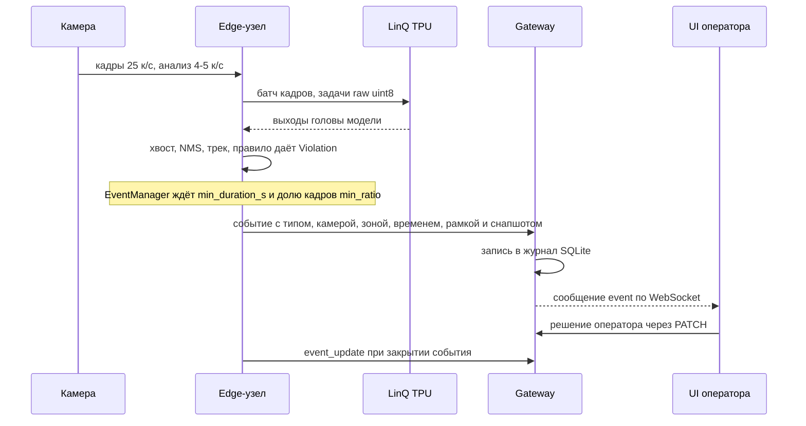

# Архитектура «Зазеркалья»

Коротко: видео с камер обрабатывается на **edge-узле рядом с ускорителем LinQ**. Там идут декод, препроцессинг, инференс на TPU, трекинг, правила и подтверждение событий. Наружу уходят только подтверждённые события со снапшотом и ограниченная телеметрия: метрики, каталог камер и превью кадра JPEG с метаданными — не чаще 1 кадра в секунду на камеру. **Шлюз** (gateway) у оператора принимает их, ведёт журнал в SQLite и отдаёт веб-интерфейсу HTTP API и WebSocket.

Контракты модулей и API описаны в `docs/CONTRACTS.md`, типы — в `guard/contracts.py`.

## 1. Схема

```mermaid
flowchart LR
    subgraph SRC["Источники"]
        CAM["IP-камеры RTSP"]
        FILES["Видеофайлы и папки кадров"]
    end

    subgraph EDGE["Edge-узел LinQ: процесс edge рядом с TPU"]
        DEC["Декод и выборка кадров с частотой sample_fps"]
        PRE["Препроцессинг: letterbox и упаковка raw uint8"]
        TPU["LinQ TPU: голова YOLOv8 det и pose, окно 4-8 задач в полёте"]
        TAIL["Хвост модели на CPU, декод и NMS"]
        TRK["Трекинг ByteTrack и атрибуты человека"]
        RULES["Правила-плагины: 13 типов нарушений"]
        EM["EventManager: подтверждение, дедуп, закрытие"]
        MEDIA["Снапшот JPEG, событие и outbox в SQLite"]
    end

    subgraph BUS["Канал"]
        MQ["RabbitMQ: exchange guard.edge.v1"]
    end

    subgraph GW["Gateway у оператора"]
        RECV["Приём: receipt и событие в SQLite до ACK"]
        JOURNAL["Журнал SQLite и статистика"]
        API["HTTP API FastAPI"]
        WS["WebSocket /ws/events"]
    end

    UI["Веб-интерфейс React: мониторинг, карточка события, журнал, аналитика, зоны и правила, производительность, данные, сотрудники"]

    CAM --> DEC
    FILES --> DEC
    DEC --> PRE --> TPU --> TAIL --> TRK --> RULES --> EM
    EM --> MEDIA
    EM -->|события из outbox, превью, метрики, камеры| MQ
    MQ --> RECV
    RECV --> JOURNAL
    RECV --> WS
    JOURNAL --> API
    API --> UI
    WS --> UI
    UI -->|зоны, правила, решения оператора| API
```

На стенде хакатона TPU доступен не по PCIe, а через облачный воркер LinQ: exchange `tpu.direct`, очередь `input`. Процесс edge работает в Jupyter-контейнере стенда, где брокер отвечает за 1 мс (`docs/LINQ_NOTES.md` §6, §9). Для продукта это эквивалент edge-узла на площадке. Код инференса тот же — бэкенд `linq-tpu` (`guard/inference/linq_tpu.py`).

### Жизненный путь одной тревоги

## 2. Режимы запуска

Режимы заданы в `docs/CONTRACTS.md` («Уточнения API», D-005).

| Режим | Где работает конвейер | Где журнал, API и UI | Инференс | Статус |
|---|---|---|---|---|
| `local` | ноутбук | там же, один процесс `uvicorn guard.api.app:app` | `onnx-cpu`, или `linq-tpu` через VPN (медленно, см. §3) | **работает**: демо-конфиг `configs/cameras.yaml` — 4 камеры (S1–S4); скриншоты `deliverables/screens/real-*.jpg` сняты в этом режиме |
| `edge` | сервер стенда (Jupyter-контейнер) рядом с TPU | — | `linq-tpu`, `raw=True` | **работает** на стенде с 24.10 09:46: 4 камеры на TPU по 4.8–4.9 к/с, сквозная задержка p50 2.20 с (`docs/EDGE.md`; замеры сняты на прежнем транспорте `zazerkalye`). В main — `python -m guard.edge`, SQLite outbox и протокол `guard.edge.v1` (`docs/EDGE_PROTOCOL.md`) |
| `gateway` | — | ноутбук или рабочее место оператора | — | **работает**: `scripts/run_tpu.sh`. Модели и источники не нужны; каталог камер приходит с edge и на шлюзе только читается (HTTP 409 на правку) |

В режиме edge + gateway шлюз показывает превью с edge: JPEG не чаще 1 кадра в секунду на камеру, шириной до 480 пикс., рамки рисуются по метаданным того же кадра (`GUARD_PREVIEW_*`, README). Живое видео через VPN-канал не идёт (§3). Клипы ±5 с между edge и шлюзом пока не передаются: в карточке на шлюзе — снапшот, клип есть в режиме local. Прежний транспорт `zazerkalye`, на котором сняты замеры `docs/EDGE.md`, проигрывал на шлюзе те же видеофайлы и рисовал рамки по `frame_meta` каждого кадра.

## 3. Почему конвейер на edge, а не на ноутбуке (D-005)

Решение принято по замерам 24.10 00:52–01:26 МСК. Цифры — `docs/BENCHMARKS.md` §4, ключи `laptop.*` и `jupyter.*` в `tpu-baseline.json`.

| Что | Ноутбук через VPN | Рядом с TPU (Jupyter стенда) |
|---|---|---|
| RTT до брокера, p50 | 235.5 мс | 1.04 мс |
| Петля 1 МБ через брокер, p50 | 7.95 с | 0.10 с |
| Петля 5 МБ через брокер, p50 | 27.6 с | 0.90 с |
| YOLOv8n det 480 raw, total p50 на кадр | **3305 мс** (0.29 к/с) | **40.5 мс** (22.8 к/с, при окне 8 — 45.7 к/с) |
| resnet50 (пример организаторов), total p50 | 712 мс | 100.7 мс |

- Обратный канал «стенд → ноутбук» — 0.1–0.4 МБ/с. Вход YOLO 480 весит 2.76 МБ в float32 (`laptop.tpu.yolov8n_480.request_bytes`). Возить кадры и тензоры через канал бессмысленно.
- Событие весом 2 КБ идёт со стенда на ноутбук за 467 мс (p50), канал держит 42 сообщения/с. Снапшот 60 КБ — 703 мс (p50), до 5.8 сообщения/с (`laptop.channel_server_to_client`). Для потока событий этого хватает с запасом.
- Ограничение edge-контейнера — 1.5 CPU и 4 ГиБ (`jupyter.container_limits`). Поэтому `OMP_NUM_THREADS=2`, батч кадров между камерами (`GUARD_MAX_BATCH=8`) и raw-упаковка на numpy (LINQ_NOTES §12–15).
- Это совпадает и с продуктовой моделью: узел LinQ стоит на площадке рядом с камерами, а оператор подключается к нему по сети. Видео не покидает периметр предприятия, по сети ходят только события. Такую схему кейс указывает в «Направлениях развития» как edge-обработку на площадке.

## 4. Модули

| Слой | Модуль | Что делает |
|---|---|---|
| Источники | `guard/sources/` | `file`, `rtsp`, `images` (папка кадров = стоп-кадры из R1), `webcam`; темп реального времени, зацикливание |
| Инференс | `guard/inference/` | `InferenceBackend`: `onnx_cpu.py` и `linq_tpu.py` (protobuf облачного протокола, raw-кодек, окно задач, ретраи, хвост модели на CPU). Выбор по `GUARD_BACKEND` |
| Зрение | `guard/vision/` | letterbox, декод YOLOv8 det и pose, NMS на numpy, отрисовка оверлеев |
| Трекинг | `guard/tracking/` | ByteTrack отдельно для людей и техники; атрибуты человека: каска, жилет, респиратор, телефон, поза, keypoint'ы; скорость в высотах тела в секунду |
| Конвейер | `guard/pipeline/` | `engine.py` — камеры с горячим перезапуском, общие детекторы, батчинг кадров между камерами. `worker.py` — камера: выборка → модели → треки → правила → EventManager. `bus.py` — шина WS |
| Правила | `guard/rules/base.py`, `guard/rules/plugins/` | API плагина, реестр, геометрия зон и расписаний |
| События | `guard/events/manager.py` | окно подтверждения (`min_duration_s`, `min_ratio`), одно событие на (камера, правило, трек), дедуп по IoU ≥ 0.3 при смене трека в пределах `cooldown_s`, закрытие через `close_after_s` |
| Журнал | `guard/events/journal.py` | SQLite: фильтры по типу, камере, зоне, статусу, важности и времени; статистика по типам, камерам, зонам, часам, дням, «день недели × час» |
| Медиа | `guard/events/media.py` | кольцевой буфер кадров; снапшот JPEG сразу при подтверждении; клип H.264 ±5 с в фоне (local; edge клипы не пишет) |
| Edge | `guard/edge/` | `python -m guard.edge`: конвейер без API и UI; событие и outbox в одной транзакции SQLite, публикация событий и телеметрии (`runner.py`) |
| Шлюз | `guard/gateway/` | receipt и событие в SQLite до ACK, подавление повторов, превью кадров с edge, каталог камер только для чтения |
| Транспорт | `guard/transport/` | конверт wire v1 (`protocol.py`), состояния outbox и receipt (`store.py`), AMQP (`rabbit.py`); протокол — `docs/EDGE_PROTOCOL.md` |
| Маховик данных | `guard/flywheel/`, `guard/api/flywheel.py`, `ml/flywheel/` | сбор сэмплов в фоне (кадр события, неуверенная рамка, мигание трека, решение оператора), хранилище, API `/api/flywheel/*`, авторазметка учителем, экспорт в YOLO, дообучение и гейт. На edge сэмплы идут на шлюз своей очередью AMQP (`edge.py`, `amqp.py`), не больше 4 КБ/с на камеру (`docs/FLYWHEEL.md`) |
| Сотрудники | `guard/employees.py`, `guard/api/employees.py` | справочник сотрудников, виновники инцидента в карточке события, персональная статистика (`docs/EMPLOYEES.md`) |
| Проверка конфигурации | `guard/doctor.py` | `python -m guard.doctor`: офлайн-проверка YAML камер и реестра моделей, путей к источникам и файлам моделей |
| Отчёты | `guard/reports/shift_report.py`, `guard/api/reports.py` | сводка за смену или период: распределения, доля ложных, горячие точки, сравнение с прошлым периодом. API: `GET /api/reports/shift` (JSON, HTML, Markdown) и `GET /api/reports/presets` |
| API | `guard/api/app.py` | REST и WebSocket по `docs/CONTRACTS.md`; раздаёт собранный фронтенд |
| UI | `frontend/` | React + TypeScript: 8 экранов, включая «Данные» (маховик) и «Сотрудники»; локальный выбор роли (`docs/ROLES.md`); мок-режим для резервного демо (`frontend/README.md`) |
| TPU-инструменты | `tpu/` | компиляция ONNX → `.tpu` с обрезкой головы, калибровка, замеры, сверка с CPU |

## 5. Как обеспечены «одно нарушение — одно оповещение» и защита от ложных тревог

1. **Правило без памяти.** `RulePlugin.evaluate(ctx)` только отвечает, есть ли нарушение на этом кадре. Логика подтверждения не размазана по плагинам.
2. **Окно подтверждения.** `EventManager` поднимает событие, только если нарушение длится `min_duration_s` (в демо 2 с) и встречается не меньше чем на `min_ratio` (0.7) кадров окна. Случайный кадр тревогу не поднимает (R4).
3. **Одно событие на трек.** Ключ — (камера, правило, трек). Пока трек жив, повторов нет.
4. **Дедуп при смене ID трека.** Новое нарушение с IoU ≥ 0.3 к открытому или недавно закрытому событию того же правила в пределах `cooldown_s` новым событием не считается.
5. **Консервативные правила.** Например, `ppe_missing` срабатывает только на явно отсутствующее СИЗ: «не видно» (`None`) нарушением не считается.
6. **Обратная связь оператора.** Статусы «подтверждено», «ложное», «передано мастеру» пишутся в журнал. В аналитике видна доля ложных по каждому правилу — по ней настраиваются пороги и набираются данные для дообучения (D4).

## 6. Точки расширения

| Что добавить | Куда | Что менять в конвейере |
|---|---|---|
| **Новый тип нарушения** (R7) | новый файл в `guard/rules/plugins/`: класс-наследник `RulePlugin` с `@register_rule`, `type`, `title`, `required_models`, `params_schema` и методом `evaluate()` | ничего: плагины находятся автоматически (`load_plugins`). UI берёт название из `/api/rules/types` и строит форму параметров по `params_schema` |
| **Новая модель** (СИЗ, огонь, дым) | ONNX → `tpu/compile.py` → `.tpu`; запись `ModelSpec` в `configs/models.yaml` | ничего: детектор подхватывает модель, плагин запрашивает её через `required_models` |
| **Новый бэкенд инференса** (другой ускоритель, локальный PCIe LinQ) | реализация `InferenceBackend` и строка в `_MODULES` в `guard/inference/__init__.py` | ничего: выбор по `GUARD_BACKEND` |
| **Новый тип источника** | класс в `guard/sources/` и ветка в `make_source` | ничего |
| **Интеграции** (СКУД, MES, мессенджеры, световая или звуковая сигнализация у зоны) | подписчик на WS `/ws/events` или на exchange `guard.edge.v1` | ничего: события уже идут через шину |
| **Новая камера, зона или расписание** | UI: экран «Камеры и правила» или `PUT /api/cameras/{id}` в режиме local; в edge + gateway — конфиг камер edge (шлюз отвечает 409) | ничего, без перезапуска процесса в режиме local |

Пример плагина — `guard/rules/plugins/running.py` (бег, 129 строк вместе со схемой параметров). Пошаговая инструкция — в `README.md`, раздел «Как добавить новый тип нарушения».

## 7. Масштабирование

- Один узел: сколько камер выдерживает один TPU, считается по формуле из `docs/BENCHMARKS.md` §5. При анализе 5 к/с на камеру выходит около 9 камер на det 480 и около 4 камер на det + pose 480 — в контейнере с 1.5 CPU.
- Больше камер — больше edge-узлов. Каждый узел публикует события со своим `edge_id` в очереди `guard.gateway.<edge_id>.*` exchange `guard.edge.v1`. Сейчас шлюз обслуживает один edge (`GUARD_EDGE_ID`); сведение нескольких узлов в общий журнал — следующий шаг. Площадки различаются полем `site` камеры, по нему уже есть фильтры и статистика.
- Батчинг кадров между камерами (`GUARD_BATCHING`, `GUARD_MAX_BATCH`) включён по умолчанию: кадры нескольких камер уходят на TPU одним окном.
